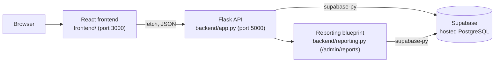

# Volunteer Management App

A full-stack web app to register volunteers, create events, match volunteers to events by skill, and track volunteer history, built with React, Flask and Supabase (hosted PostgreSQL).

University of Houston course project (Aug to Dec 2024), built by a team of four.

## Features

- **Registration and login**: email and password forms with client-side validation (Formik and Yup). The backend hashes passwords with bcrypt.
- **Profile management**: volunteers enter personal details, skills, preferences and availability.
- **Event management (admin)**: create events with required skills, urgency, location and date.
- **Volunteer matching (admin)**: score volunteers against an event's required skills (case-insensitive overlap, 50% threshold). See Known limitations.
- **Notifications**: toast notifications for new events, updates and assignments.
- **Volunteer history**: list a volunteer's past events and add new entries.
- **Reports (admin)**: export events and volunteer history as CSV or PDF (ReportLab).

## Tech stack

| Layer | Technology |
|-------|------------|
| Frontend | React 18 (Create React App), react-router-dom, Formik, Yup, react-toastify, react-select, react-datepicker |
| Backend | Python, Flask, flask-cors, bcrypt, ReportLab |
| Database | Supabase (hosted PostgreSQL), accessed with the `supabase` Python client |
| Testing | pytest / unittest (backend), Jest and React Testing Library (frontend) |

## Architecture



- `frontend/`: React single-page app. Routes: `/login`, `/register`, `/profile`, `/eventform`, `/volunteerMatch`, `/volunteerHistory`.
- `backend/app.py`: REST API for registration, login, events, matching, notifications and volunteer history.
- `backend/reporting.py`: Flask blueprint mounted at `/admin` that serves CSV and PDF reports.
- `backend/supabaseClient.py`: standalone helpers for creating and authenticating users with hashed passwords.
- `database/schema.sql`: SQL for the Supabase tables, indexes and row-level security policies.

Main API routes:

| Method | Route | Purpose |
|--------|-------|---------|
| POST | `/register` | Create a user (password hashed with bcrypt) |
| POST | `/login` | Check username and password |
| GET, POST | `/eventform` | List or create events |
| GET | `/matches/event/<event_name>` | Best volunteer matches for an event |
| GET | `/matches/volunteer/<username>` | Matching events for a volunteer |
| GET, POST | `/volunteer/<username>/history` | Read or add volunteer history |
| GET | `/admin/reports/events?format=csv\|pdf` | Events report |
| GET | `/admin/reports/volunteerhistory?format=csv\|pdf` | Volunteer history report |

## Getting started

Prerequisites: Python 3.10 or newer, Node.js 18 or newer, and (for anything that touches data) a Supabase project.

These steps were verified on Windows 11 with Python 3.13 and Node.js 24.

### 1. Backend

```bash
cd backend
python -m venv venv
# Windows:      venv\Scripts\activate
# macOS/Linux:  source venv/bin/activate
pip install -r requirements.txt

cp .env.example .env    # then fill in your Supabase URL and key
python app.py           # serves the API on http://localhost:5000
```

`app.py` creates the Supabase client at startup, so `SUPABASE_URL` and `SUPABASE_KEY` must be set before it will start.

### 2. Frontend

```bash
cd frontend
npm ci
npm start               # opens http://localhost:3000
```

From the repo root, `npm start`, `npm run build` and `npm test` are shortcuts that run the same commands inside `frontend/`.

## Environment variables

Defined in `backend/.env` (copy from [`backend/.env.example`](backend/.env.example)). Never commit the real `.env` file; it is in `.gitignore`.

| Variable | Description |
|----------|-------------|
| `SUPABASE_URL` | Your Supabase project URL, e.g. `https://<project-ref>.supabase.co` |
| `SUPABASE_KEY` | Your Supabase project API key (anon/publishable key for local development) |

The frontend needs no environment variables. It calls the backend at `http://localhost:5000`.

To create the tables in a new Supabase project, run `database/schema.sql` in the Supabase SQL editor.

## Running tests

### Backend

```bash
cd backend
pytest -rs
```

Without Supabase credentials (verified):

```
10 passed, 7 skipped
```

- `tests/test_offline_helpers.py` (10 tests) runs with no database. It covers skill matching, input validation and CSV/PDF report generation.
- The Supabase integration tests (`test_eventform.py`, `test_volunteerMatching.py`, `test_volunteerHistory.py`, `test_supabase_client.py`) skip automatically when `SUPABASE_URL` and `SUPABASE_KEY` are not set. **Run them only against a throwaway Supabase project**: `test_volunteerHistory.py` deletes every row in the `users` and `volunteerhistory` tables during setup and teardown.
- `test_login.py`, `test_profilemanagement.py` and `test_notificationSystem.py` are skipped as legacy. They were written for an earlier in-memory version of the backend and import a `db` object that `app.py` no longer defines.

### Frontend

```bash
cd frontend
CI=true npm test        # Windows PowerShell: $env:CI="true"; npm test
npm run build
```

Verified: 1 test suite, 1 test passing, and the production build compiles (with one unused-variable lint warning).

## Known limitations

This is a course project and some parts were left mid-migration from in-memory storage to Supabase:

- Matching (`/matches/event/...`, `/matches/volunteer/...`) and the notification routes still reference the old in-memory `db` object, so they return HTTP 500 at runtime.
- Most frontend pages use dummy data. Only the Volunteer History page calls the backend.
- `database/schema.sql` does not define every column the backend writes to `volunteerhistory` (for example `eventname`, `location`, `participationstatus`), so check the schema against your project before relying on it.

## My role

Adam Kaddour-Djebbar created the repository and was its most active contributor. His work:

- **Frontend:** the login, registration and profile pages in React, with form validation and CSS Modules.
- **Backend:** the registration, login and user-profile management endpoints in Flask, with bcrypt password hashing.
- **Database:** the initial PostgreSQL schema (`database/schema.sql`) and the Supabase integration layer (`backend/supabaseClient.py`).
- **Testing:** unit tests for login, profile management, user profiles and credentials, raising backend test coverage to 83% in November 2024.
- **2026 cleanup:** the portfolio polish in this README (dependency cleanup, environment-based configuration, working test suite and setup docs).

## Team and credits

Built by a four-person team. Contributors are listed as they appear in the commit history; counts are from `git shortlog -sn` on `main` (the repo owner's two author identities combined):

| Contributor | GitHub | Commits |
|-------------|--------|---------|
| Adam Kaddour-Djebbar | [@DM8581912](https://github.com/DM8581912) | 24 |
| daviddinh1 | [@daviddinh1](https://github.com/daviddinh1) | 21 |
| Kevin21 | [@KevinVu21](https://github.com/KevinVu21) | 17 |
| Fufuos | [@Fufuos](https://github.com/Fufuos) | 10 |
